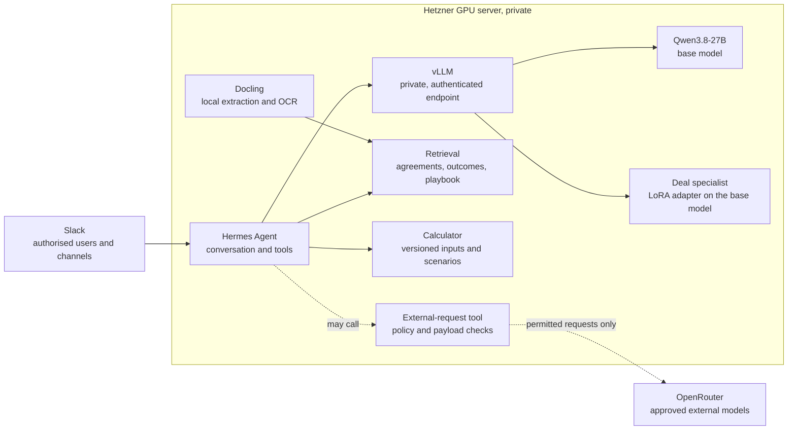

# Contract assistant

The contract assistant drafts terms for new commercial agreements. People use it through Slack. For each new proposal, it drafts two or three possible structures. Each structure sets out an amount range, the milestones, the evidence that verifies each milestone and the payment schedule. Each structure is measured against the value the agreement is expected to create. A person reviews every proposal and approves the terms. The assistant never sends an offer or triggers a payment. It also finds and cites past agreements.

The assistant runs on one private GPU server at Hetzner in the EU. Only permitted tasks can reach an external model. The base model is Qwen3.8-27B, an open-weight model. It is served with vLLM, an open-source inference server. The deal specialist is a LoRA adapter on that model: a small set of trained weights, fine-tuned to apply the approved assessment method. Retrieval supplies past agreements, their outcomes and the playbook at request time. The playbook holds the approved rules for structuring a deal. Every amount comes from a calculator with versioned inputs.

> This repository holds the documentation only. It contains no agreements, datasets, model weights or credentials.

## How it works

A proposal arrives in Slack. Hermes Agent, the open-source agent that runs the conversation, checks who is asking. The deal specialist asks for any input that is missing. Retrieval returns comparable past agreements, their outcomes and the current playbook, limited to what that person may see. The calculator turns explicit inputs into low, base and high scenarios. The specialist compares the precedents, drafts the structures and flags weak evidence. Hermes Agent posts a memo with its sources. A person decides.

## Stack

| Layer | Choice |
| --- | --- |
| Hosting | A [Hetzner dedicated GPU server](https://www.hetzner.com/dedicated-rootserver/matrix-gpu/) with one NVIDIA RTX PRO 6000 Blackwell Max-Q (96 GB), administered by SSH over Tailscale |
| Base model | [Qwen3.8-27B](https://huggingface.co/Qwen/Qwen3.8-27B): Apache 2.0, a dense model with 27B parameters and a 262k context window |
| Deal specialist | A LoRA adapter on the base model, trained on reviewed assessments |
| Serving | vLLM, with the base model and the adapter behind one private, authenticated endpoint |
| Extraction | Docling, with local OCR |
| Retrieval | A private store of agreements, outcome records and the playbook, with source references and access checks |
| Calculator | Versioned assumptions that turn explicit inputs into low, base and high scenarios |
| Agent | Hermes Agent, connected to Slack in Socket Mode |
| External models | OpenRouter, a service that routes requests to external models. It is reached only through a separate tool that checks every outgoing request |
| Training | Transformers, Datasets, TRL and PEFT, on PyTorch and NVIDIA CUDA |

## Why Qwen3.8-27B

The base model has to meet five requirements:

1. It fits one 96 GB GPU.
2. vLLM can serve a LoRA adapter on it.
3. Its licence allows commercial use.
4. It calls tools reliably through Hermes Agent.
5. It holds long agreements in context.

A public benchmark index draws the shortlist. A test on representative cases makes the choice. Qwen3.8-27B is the base model. Nanbeige4.3-33B scores within half a point of it and is the next candidate for that test. The other higher-scoring open models that were checked need Hetzner's four-GPU server. Details are under [how the model is chosen](docs/architecture.md#how-the-model-is-chosen).

## Design principles

1. **Private by default.** The model, the adapter, retrieval, the calculator and the agent all run on the private server. Summaries and context compression, which shortens long conversations, use the private model too.
2. **People decide.** The assistant prepares a memo with sources. A person approves every term. The assistant never sends an offer or triggers a payment.
3. **Numbers come from the calculator.** Every amount traces back to explicit, versioned inputs. The model explains the calculation. It does not produce the figures.
4. **Retrieval holds the history.** Retrieval supplies agreements, outcomes and the playbook at request time. A new agreement is ingested, not trained in. The adapter is trained to apply the method, not to recall the deals.
5. **Permissions in code.** Access rules are enforced in application code, never left to a prompt or to the model's judgement. They are checked before retrieval, and again before an answer is posted into a shared channel.
6. **External models only through a checked tool.** A separate tool checks the task, how confidential the data is, whether the provider is approved, and the exact outgoing text. It never forwards the conversation. It is never a fallback when the private model fails. Details are under [routing and privacy](docs/architecture.md#routing-and-privacy).
7. **Evidence before deployment.** The adapter goes into service only if it beats the untuned model with the same retrieval and calculator, or reaches acceptable quality at a lower total cost. Reviewers judge both blind, on cases set aside for testing, against pass marks fixed in advance.

## Documents

| Document | Contents |
| --- | --- |
| [Architecture](docs/architecture.md) | Components, the base model and the specialist, how the model is chosen, the request flow, routing and privacy, Slack access |
| [Data and training](docs/data-and-training.md) | How value is defined, case records, what the specialist learns, the training sequence, rules for training data, toolchain |
| [Evaluation](docs/evaluation.md) | Reserved test cases, comparisons, blind review, system checks, acceptance criteria, cost, and what the evaluation cannot prove |
| [Rollout](docs/rollout.md) | The five delivery phases and the exit check for each |
