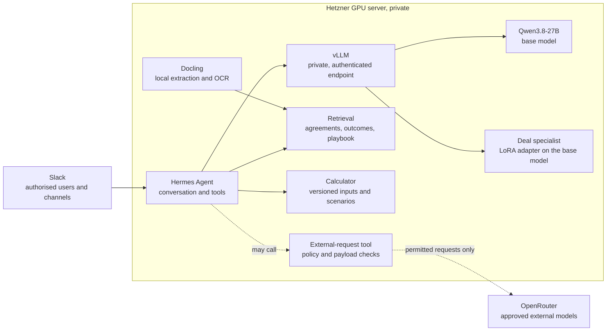
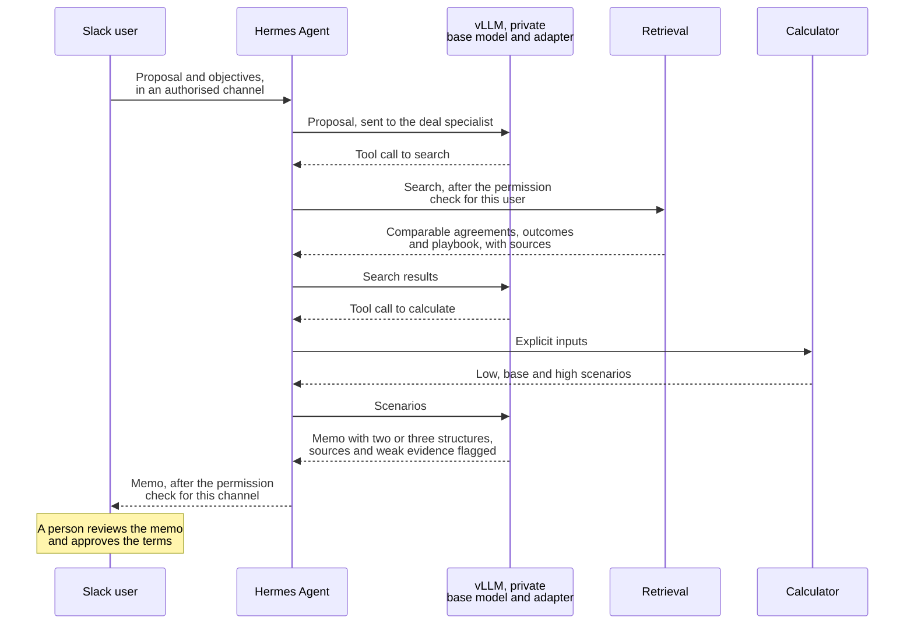

# Architecture

## Overview

A request starts in Slack. Hermes Agent runs the conversation. It calls the approved tools. It sends every model call to vLLM on the private server. vLLM serves the base model and the deal specialist. Retrieval and the calculator run on the same server. OpenRouter is reached only through the external-request tool, which checks each request before anything leaves.

## Components

| Component | Tool | Role |
| --- | --- | --- |
| Hosting | [Hetzner dedicated GPU server](https://www.hetzner.com/dedicated-rootserver/matrix-gpu/) | Runs everything private: the model, the adapter, retrieval, the calculator and the agent |
| Admin access | [SSH over Tailscale](https://tailscale.com/docs/features/tailscale-ssh) | Private administration of the server |
| Extraction | [Docling](https://docling-project.github.io/docling/) with local OCR | Turns PDF and Word agreements into text and tables. It keeps page references for PDFs |
| Model source | [Hugging Face Hub](https://huggingface.co/docs/hub) | Model weights are downloaded directly onto the server. Agreements are never uploaded |
| Serving | [vLLM](https://docs.vllm.ai/en/latest/features/lora/) | Serves the base model and the adapter from one private, authenticated endpoint |
| Retrieval | Private store and search | Holds the agreements, the extracted evidence, the outcome records and the playbook of approved deal rules. It applies access checks and returns comparable agreements with their sources |
| Calculator | Custom calculation rules, versioned | Turns explicit inputs into low, base and high scenarios. The business approves its assumptions and value definitions |
| Agent | [Hermes Agent](https://hermes-agent.nousresearch.com/docs/user-guide/messaging/slack) | Runs the conversation in Slack and calls the approved tools |
| External-request tool | Custom code | Checks the task, the data classification, the provider and the exact outgoing text before anything reaches OpenRouter |
| External models | [OpenRouter](https://openrouter.ai/docs/guides/routing/provider-selection) | Approved external models, for permitted public or sanitised tasks only |

## Base model and specialist

The base model is [Qwen3.8-27B](https://huggingface.co/Qwen/Qwen3.8-27B), an open-weight model self-hosted on vLLM. The deal specialist is a LoRA adapter on it. A LoRA adapter is a small set of trained weights that sits on top of the frozen base model.

vLLM serves the adapter next to the base model from one process, each under its own model name ([vLLM documentation on LoRA adapters](https://docs.vllm.ai/en/latest/features/lora/)). The specialist takes new proposals. The base model takes questions about past agreements and general private tasks. The specialist is an adapter, not a second copy of the model. Both therefore fit on the one GPU.

### Why this model

According to its model card on 5 November 2026:

- Apache 2.0 licence
- a dense model with 27B parameters
- three of every four layers use Gated DeltaNet, a linear-attention design whose memory does not grow with the context
- every fourth layer uses full attention
- 262,144 tokens of context natively, extensible to 1,000,000
- thinking that can be switched on or off

The weights ship in BF16, a 16-bit format. They take about 56 GB. That leaves room on the 96 GB card for the adapter and the KV cache, which holds the context of each request. Qwen3.8-27B uses the Qwen3.5 architecture. vLLM lists LoRA support for that architecture ([supported models](https://docs.vllm.ai/en/latest/models/supported_models/)). A listing does not prove that a given adapter loads. Each trained adapter is therefore tested on the exact checkpoint before it goes into service.

### How the model is chosen

The base model has to meet five requirements:

1. It fits one 96 GB GPU, together with the adapter and the KV cache.
2. vLLM can serve a LoRA adapter on it.
3. Its licence allows commercial use.
4. It calls tools reliably through Hermes Agent.
5. It holds long agreements and their evidence in context. [Hermes Agent's documentation](https://hermes-agent.nousresearch.com/docs/integrations/providers) asks for at least 64,000 tokens of context for agent use with tools.

The [Artificial Analysis Intelligence Index](https://artificialanalysis.ai/leaderboards/models) draws the shortlist from the models that meet all five. A feasibility and quality test on representative cases makes the choice. The chosen model then has to pass the same evaluation as any other change.

These candidates were checked on 5 November 2026:

| Model | Hetzner hardware it needs | LoRA adapters in vLLM | Licence |
| --- | --- | --- | --- |
| [Qwen3.8-27B](https://huggingface.co/Qwen/Qwen3.8-27B) | One 96 GB GPU | Supported | Apache 2.0 |
| [Nanbeige4.3-33B](https://huggingface.co/Nanbeige/Nanbeige4.3-33B) | One 96 GB GPU | Supported | Apache 2.0 |
| [NVIDIA Nemotron 3.5 Super VL](https://huggingface.co/nvidia/NVIDIA-Nemotron-3.5-Super-VL-120B-A12B-NVFP4) | One 96 GB GPU, with NVIDIA's 4-bit build | Supported | OpenMDW 1.1 |
| [GLM-5.3-Flash](https://huggingface.co/zai-org/GLM-5.3-Flash) | Four GPUs, with NVIDIA's 4-bit build | Not on vLLM's supported list | MIT |
| [MiniMax-M3.1-Flash](https://huggingface.co/MiniMaxAI/MiniMax-M3.1-Flash) | Four GPUs | Not supported | MiniMax community licence |
| [MiMo-V2.6-Flash](https://huggingface.co/XiaomiMiMo/MiMo-V2.6-Flash-RL) | Four GPUs | Not supported | MIT |

Qwen3.8-27B and Nanbeige4.3-33B score within half a point of each other on the index. Both fit one GPU, take LoRA adapters in vLLM and carry the Apache 2.0 licence. Qwen3.8-27B is the base model. Nanbeige4.3-33B is the next candidate for the same test. Nemotron 3.5 Super VL also fits one GPU and takes adapters. With thinking switched on, Qwen3.8-27B scores higher than Nemotron 3.5 Super VL.

GLM-5.3-Flash, MiniMax-M3.1-Flash and MiMo-V2.6-Flash score higher than Qwen3.8-27B. They fit only on Hetzner's four-GPU server. vLLM's supported-models list shows LoRA for none of them. vLLM's code declares adapter support for GLM-5.3-Flash, but that support is not yet tested. If vLLM adds tested adapter support for a larger model, the comparison runs again on the same reserved cases, which are set aside for testing.

Every model in service has to pass five checks:

1. The licence terms of the exact checkpoint.
2. Tool calling end to end, from Hermes Agent to vLLM ([vLLM documentation on tool calling](https://docs.vllm.ai/en/latest/features/tool_calling/)).
3. Context length, with long agreements and their retrieved evidence in the prompt.
4. Memory use and speed on the one GPU, with the base model and the adapter loaded together.
5. Quality on reserved cases against the model or adapter it would replace.

### Server

The server has one NVIDIA RTX PRO 6000 Blackwell Max-Q with 96 GB of GPU memory. Hetzner's single-GPU GEX63 and GEX131 servers carry this card. Both run in EU data centres ([GPU servers](https://www.hetzner.com/dedicated-rootserver/matrix-gpu/)). Qwen3.8-27B and the adapter run together on it. Training runs as a separate job, because training can need more memory than serving.

## Request flow

The model asks for a tool. Hermes Agent runs it. The permission checks run in that tool code, not in the model. If an input is missing, the specialist asks for it before drafting. The memo names the comparable agreements and shows how they differ. It also flags the evidence that is weak.

## Routing and privacy

### Routes

| Request | Route | Condition |
| --- | --- | --- |
| A new proposal | Deal specialist with retrieval and the calculator, private | None |
| A question about past agreements | Base model with retrieval, private | None |
| General private tasks, summaries and context compression | Base model, private | None |
| A public or sanitised task for an approved external model | External-request tool, then OpenRouter | The tool's checks pass for the task, the data classification, the provider and the exact outgoing text |

### Rules

1. Complexity alone never authorises external processing. What decides is whether the data may leave under the confidentiality policy.
2. Permissions are enforced in application code. They are not left to a prompt or to the model's judgement.
3. The whole request counts, not just the question: conversation history, attachments, retrieved passages, summaries, OCR, embeddings and fallbacks.
4. Text inside a document is data. An instruction found inside a document is never followed.
5. Private requests never fall back to an external provider. If permission is unclear or the private model fails, the assistant says so and keeps the content private.
6. Permissions are checked before retrieval, and again before an answer is posted into a shared Slack channel.
7. The vLLM endpoint is private and needs authentication.
8. An audit trail records each request and decision. It copies no more confidential material than it needs.
9. Source data, training artefacts, credentials, logs and backups are protected like the agreements themselves.

### Where content could leave the server

Each path has one control.

| Path | Control |
| --- | --- |
| Conversation history | The external-request tool never forwards the conversation. It sends only the exact text it has checked |
| Attachments | A file posted in Slack is classified before any external model can receive it |
| Retrieved passages | Passages carry the confidentiality of their source agreement into every decision |
| Summaries and context compression | They run on the private model |
| OCR | It runs on the server, with OCR engines that Docling runs locally |
| Embeddings | They are computed on the server. There is no external embedding service |
| Fallbacks | No external fallback is configured for private routes, and a test checks it. If the private model is unavailable, the request fails and says so |
| Training data | An adapter can retain what it was trained on. Training therefore uses only material that every user of the adapter may see |
| Slack itself | Questions, answers and attachments pass through Slack, under the workspace's policies. An answer posted in a channel contains only what every member of that channel may see |

### Controls on the external route

The external-request tool is the only path to an outside model. Before anything leaves, it checks the task, the data classification, the provider and the exact outgoing text. The provider has to be on the approved list. The tool never forwards the private conversation. It is never used as a fallback. OpenRouter lets a request deny data collection, require zero data retention, name the permitted providers and switch off provider fallbacks ([OpenRouter provider selection](https://openrouter.ai/docs/guides/routing/provider-selection)). External requests always name the model and the provider, with provider fallbacks switched off. The data-collection and retention settings follow the confidentiality policy.

### Slack access

Only authorised users and channels reach the assistant. Access is denied by default. Hermes Agent's [Slack integration](https://hermes-agent.nousresearch.com/docs/user-guide/messaging/slack) takes an allowlist of users and a list of allowed channels. It denies all messages when no user allowlist is set. One-to-one direct messages are exempt from the channel list. There, the user allowlist is the control that counts. Group direct messages need a place on the channel list, as channels do. The integration connects in Socket Mode. The server therefore needs no public inbound endpoint for Slack.

## References

Official documentation and model cards, checked on 5 November 2026.

- Hetzner: [GPU servers](https://www.hetzner.com/dedicated-rootserver/matrix-gpu/)
- Tailscale: [Tailscale SSH](https://tailscale.com/docs/features/tailscale-ssh)
- Docling: [documentation](https://docling-project.github.io/docling/)
- Hugging Face: [Hub](https://huggingface.co/docs/hub)
- Qwen: [Qwen3.8-27B model card](https://huggingface.co/Qwen/Qwen3.8-27B)
- vLLM: [documentation](https://docs.vllm.ai/en/latest/), [LoRA adapters](https://docs.vllm.ai/en/latest/features/lora/), [tool calling](https://docs.vllm.ai/en/latest/features/tool_calling/), [supported models](https://docs.vllm.ai/en/latest/models/supported_models/)
- Hermes Agent: [providers](https://hermes-agent.nousresearch.com/docs/integrations/providers), [Slack](https://hermes-agent.nousresearch.com/docs/user-guide/messaging/slack)
- OpenRouter: [provider selection](https://openrouter.ai/docs/guides/routing/provider-selection)
- Artificial Analysis: [model leaderboard](https://artificialanalysis.ai/leaderboards/models)
- Other candidates: [Nanbeige4.3-33B](https://huggingface.co/Nanbeige/Nanbeige4.3-33B), [Nemotron 3.5 Super VL](https://huggingface.co/nvidia/NVIDIA-Nemotron-3.5-Super-VL-120B-A12B-NVFP4), [GLM-5.3-Flash](https://huggingface.co/zai-org/GLM-5.3-Flash), [MiniMax-M3.1-Flash](https://huggingface.co/MiniMaxAI/MiniMax-M3.1-Flash), [MiMo-V2.6-Flash](https://huggingface.co/XiaomiMiMo/MiMo-V2.6-Flash-RL)
